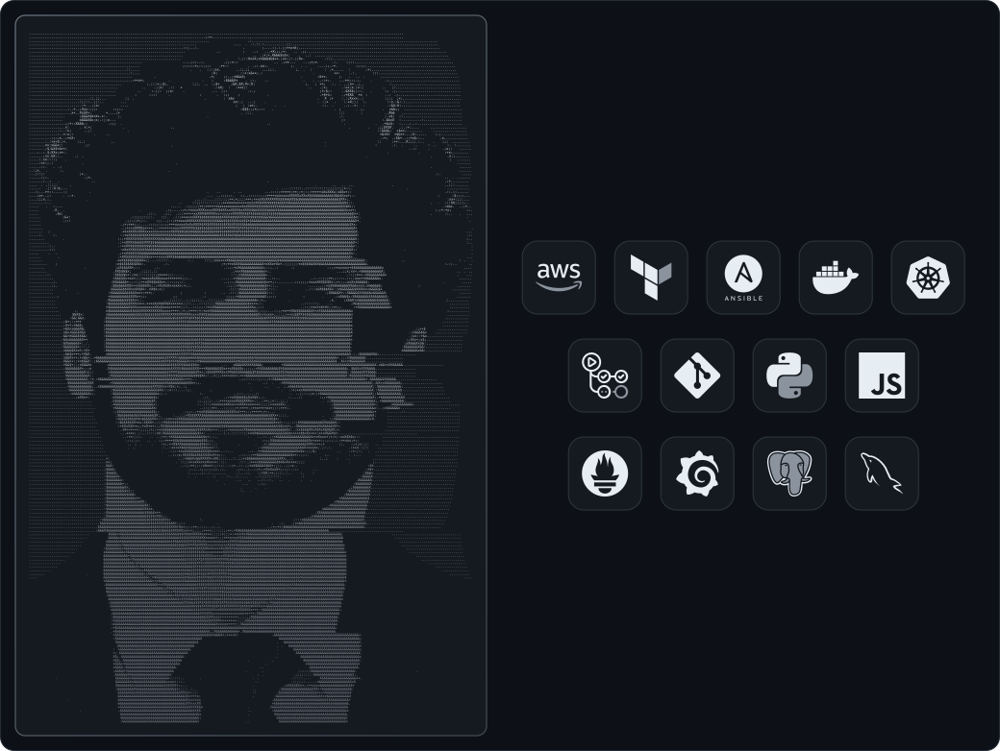

  <picture>
    <source media="(prefers-color-scheme: dark)" srcset="./profile-dark-v2.svg">
    <source media="(prefers-color-scheme: light)" srcset="./profile-light-v2.svg">
    
  </picture>

**Tools:** AWS · Terraform · Ansible · Docker · Kubernetes · GitHub Actions · Git · Python · JavaScript · Prometheus · Grafana · PostgreSQL · MySQL
